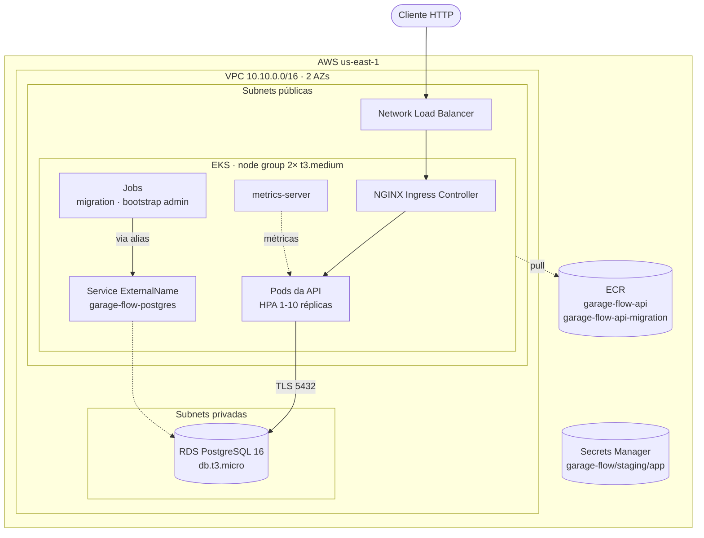
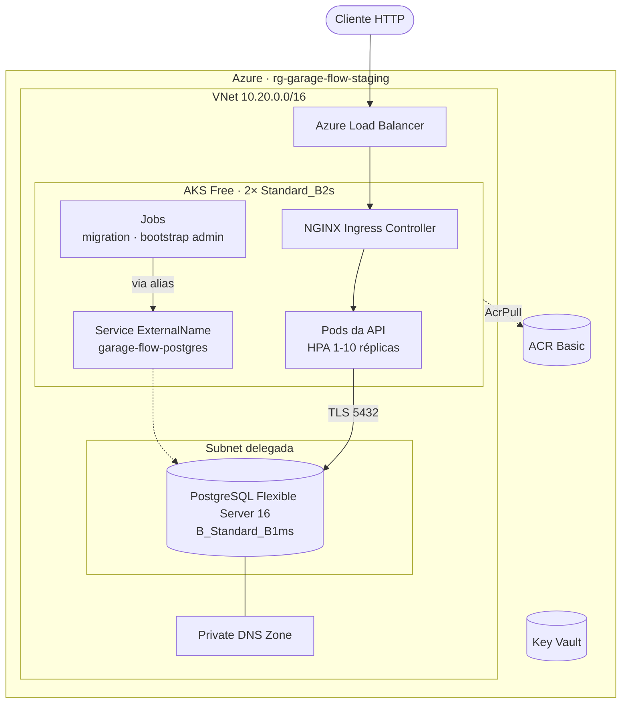
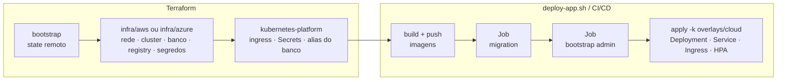

# Infraestrutura — Garage Flow API

Infraestrutura como código (Terraform) para executar a Garage Flow API em Kubernetes gerenciado, com PostgreSQL gerenciado, em **AWS** (principal, via AWS Academy Learner Lab) ou **Azure** (alternativa, via Azure for Students).

As justificativas de cada escolha, com prós, contras e alternativas descartadas, estão em [docs/decisoes-de-infraestrutura.md](docs/decisoes-de-infraestrutura.md).

## Sumário

- [Visão geral](#visão-geral)
- [Arquitetura](#arquitetura)
- [Estrutura de pastas](#estrutura-de-pastas)
- [Recursos provisionados](#recursos-provisionados)
- [Pré-requisitos](#pré-requisitos)
- [Provisionamento na AWS (Learner Lab)](#provisionamento-na-aws-learner-lab)
- [Provisionamento na Azure](#provisionamento-na-azure)
- [Deploy da aplicação](#deploy-da-aplicação)
- [Remoção da infraestrutura](#remoção-da-infraestrutura)
- [Contrato para o pipeline de CI/CD](#contrato-para-o-pipeline-de-cicd)
- [Custos estimados](#custos-estimados)
- [Solução de problemas](#solução-de-problemas)
- [Limitações conhecidas](#limitações-conhecidas)

## Visão geral

| Camada | Responsável | Conteúdo |
| --- | --- | --- |
| Infraestrutura de cloud | Terraform (`infra/aws`, `infra/azure`) | Rede, cluster Kubernetes, PostgreSQL gerenciado, registry de imagens, cofre de segredos |
| Plataforma no cluster | Terraform (`infra/modules/kubernetes-platform`) | Ingress Controller, Secrets da aplicação, alias DNS do banco |
| Aplicação | Kustomize (`k8s/` + `infra/kubernetes/overlays`) | ConfigMap, Deployment, Service, Ingress, HPA, Jobs de migration e bootstrap |

O Terraform cuida de tudo o que depende da cloud. Os manifestos de `k8s/` não são alterados: os overlays em `infra/kubernetes/overlays` reaproveitam esses arquivos e removem apenas o que, em cloud, é substituído por serviços gerenciados (PostgreSQL in-cluster e Secrets versionados).

Ambiente provisionado: **`staging`** (único).

## Arquitetura

### AWS



### Azure



### Fluxo de provisionamento e deploy



## Estrutura de pastas

```text
infra/
├── README.md                          # este guia
├── docs/
│   └── decisoes-de-infraestrutura.md  # decisões e trade-offs
├── aws/
│   ├── bootstrap/                     # bucket S3 do state remoto (state local)
│   ├── modules/
│   │   ├── network/                   # VPC, subnets, rotas, NAT opcional
│   │   ├── iam/                       # LabRole ou roles dedicadas (AWS real)
│   │   ├── cluster/                   # EKS, node group, metrics-server
│   │   ├── database/                  # RDS PostgreSQL + security group
│   │   ├── registry/                  # repositórios ECR + lifecycle
│   │   └── secrets/                   # AWS Secrets Manager
│   ├── environments/staging.tfvars
│   └── *.tf                           # stack principal
├── azure/
│   ├── bootstrap/                     # Storage Account do state remoto
│   ├── modules/{network,cluster,database,registry,secrets}/
│   ├── environments/staging.tfvars
│   └── *.tf
├── modules/
│   └── kubernetes-platform/           # recursos no cluster, comuns às duas clouds
├── kubernetes/
│   ├── components/                    # blocos Kustomize reutilizáveis
│   └── overlays/                      # cloud, cloud-migration, cloud-bootstrap-admin
└── scripts/
    ├── provision.sh                   # bootstrap + terraform apply
    ├── deploy-app.sh                  # imagens + Jobs + manifestos
    └── destroy.sh                     # remoção ordenada
```

## Recursos provisionados

### AWS

| Recurso | Configuração | Finalidade |
| --- | --- | --- |
| S3 bucket (bootstrap) | `garage-flow-tfstate-<account-id>`, versionado, criptografado | State remoto do Terraform com lock nativo (`use_lockfile`) |
| VPC | `10.10.0.0/16`, 2 AZs | Rede isolada do ambiente |
| Subnets públicas | 2× `/24`, IP público automático | Nodes do EKS e Load Balancer |
| Subnets privadas | 2× `/24`, sem rota para a internet | RDS |
| Internet Gateway | — | Saída/entrada das subnets públicas |
| NAT Gateway | desligado (`enable_nat_gateway = false`) | Opcional para produção |
| EKS cluster | Kubernetes 1.35, endpoint público + privado, standard support | Control plane gerenciado |
| EKS managed node group | 2× `t3.medium` (AL2023) | Capacidade de execução dos pods |
| EKS add-on `metrics-server` | — | Métricas de CPU/memória para o HPA |
| RDS PostgreSQL | 16, `db.t3.micro`, 20 GiB gp3 criptografado, single-AZ, privado | Banco de dados da aplicação |
| Security group do RDS | 5432 apenas a partir do security group do cluster | Isolamento do banco |
| ECR | `garage-flow-api`, `garage-flow-api-migration`, scan on push, retém 10 imagens | Registry das imagens |
| Secrets Manager | `garage-flow/staging/app` | Cópia consultável dos segredos gerados |
| IAM | `LabRole` reutilizada (Learner Lab) ou 2 roles dedicadas | Permissões do control plane e dos nodes |

### Azure

| Recurso | Configuração | Finalidade |
| --- | --- | --- |
| Storage Account (bootstrap) | `gftfstate<sufixo>`, container `tfstate`, versionado | State remoto do Terraform |
| Resource Group | `rg-garage-flow-staging` | Agrupamento e remoção em bloco |
| VNet | `10.20.0.0/16` com subnets `snet-aks` e `snet-postgres` (delegada) | Rede isolada |
| Private DNS Zone | `garage-flow-staging.private.postgres.database.azure.com` | Resolução privada do banco |
| AKS | tier Free, 2× `Standard_B2s`, Azure CNI Overlay, Managed Identity | Cluster Kubernetes gerenciado |
| Role assignments | `Network Contributor` (subnet), `AcrPull` (ACR) | Permissões da identidade do AKS |
| PostgreSQL Flexible Server | 16, `B_Standard_B1ms`, 32 GiB, acesso privado | Banco de dados da aplicação |
| ACR | Basic, sem usuário admin | Registry das imagens |
| Key Vault | soft delete 7 dias, sem purge protection | Cópia consultável dos segredos gerados |

### Dentro do cluster (ambas as clouds)

| Recurso | Origem | Finalidade |
| --- | --- | --- |
| Helm release `nginx-ingress` (namespace `ingress-nginx`) | Terraform | Ingress Controller com Service `LoadBalancer`, classe `nginx` |
| Secret `garage-flow-secrets` | Terraform | `DATABASE_URL`, `POSTGRES_*`, `JWT_SECRET`, `TRACKING_TOKEN_SECRET` |
| Secret `garage-flow-bootstrap-admin` | Terraform | Credenciais do primeiro administrador |
| Service `garage-flow-postgres` (ExternalName) | Terraform | Alias DNS para o banco gerenciado, preservando o host usado pelo Job de migration |
| ConfigMap, Deployment, Service, Ingress, HPA | `k8s/` via `overlays/cloud` | Aplicação |
| Jobs `garage-flow-migration`, `garage-flow-bootstrap-admin` | `k8s/` via overlays dedicados | Migrations e primeiro administrador |

## Pré-requisitos

| Ferramenta | Versão | Instalação (macOS) |
| --- | --- | --- |
| Terraform | ≥ 1.10 | `brew tap hashicorp/tap && brew install hashicorp/tap/terraform` |
| kubectl | ≥ 1.30 | `brew install kubectl` |
| Docker | com `buildx` | Docker Desktop |
| AWS CLI v2 | — | `brew install awscli` |
| Azure CLI | — | `brew install azure-cli` |

> O pacote `terraform` do Homebrew core está congelado na versão 1.5 por questões de licença. Use o tap oficial `hashicorp/tap`.

## Provisionamento na AWS (Learner Lab)

### 1. Credenciais

1. No AWS Academy, abra o **Learner Lab** e clique em **Start Lab** (aguarde o indicador ficar verde).
2. Em **AWS Details → AWS CLI → Show**, copie o bloco `[default]` para `~/.aws/credentials`.
3. Valide:

   ```bash
   aws sts get-caller-identity
   ```

As credenciais do Learner Lab **expiram a cada sessão (~4 horas)**. Ao reiniciar o laboratório, repita o passo 2.

### 2. Provisionar

```bash
infra/scripts/provision.sh aws
```

O script executa, em ordem:

1. `infra/aws/bootstrap`: cria o bucket S3 do state e gera `infra/aws/backend.hcl` (somente na primeira execução);
2. `terraform init -backend-config=backend.hcl`;
3. `terraform plan -var-file=environments/staging.tfvars`, seguido de uma confirmação;
4. `terraform apply`. Leva de 15 a 20 minutos, a maior parte para criar o EKS e o RDS.

<details>
<summary>Execução manual, sem o script</summary>

```bash
terraform -chdir=infra/aws/bootstrap init
terraform -chdir=infra/aws/bootstrap apply

terraform -chdir=infra/aws init -backend-config=backend.hcl
terraform -chdir=infra/aws plan -var-file=environments/staging.tfvars -out=tfplan
terraform -chdir=infra/aws apply tfplan
```

</details>

### Conta AWS real (fora do Learner Lab)

Em `infra/aws/environments/staging.tfvars`:

- remova `existing_iam_role_name = "LabRole"` para que o Terraform crie `garage-flow-staging-eks-cluster` e `garage-flow-staging-eks-node` com políticas mínimas;
- considere `enable_nat_gateway = true`, que move os nodes para subnets privadas;
- restrinja `cluster_endpoint_public_access_cidrs` ao IP da equipe ou dos runners de CI.

## Provisionamento na Azure

### 1. Credenciais

```bash
az login
az account set --subscription "<nome-ou-id-da-assinatura>"
export ARM_SUBSCRIPTION_ID="$(az account show --query id --output tsv)"
```

Assinaturas novas podem exigir o registro dos resource providers (execução única):

```bash
for ns in Microsoft.ContainerService Microsoft.DBforPostgreSQL Microsoft.ContainerRegistry Microsoft.KeyVault Microsoft.Network; do az provider register --namespace "$ns"; done
```

Assinaturas **Azure for Students** podem restringir regiões por policy. Se o apply falhar com `RequestDisallowedByPolicy`, troque `location` em `infra/azure/environments/staging.tfvars` e em `infra/azure/bootstrap` (variável `location`).

### 2. Provisionar

```bash
infra/scripts/provision.sh azure
```

## Deploy da aplicação

Com a infraestrutura provisionada:

```bash
infra/scripts/deploy-app.sh aws    # ou azure
```

| Etapa | Comando equivalente |
| --- | --- |
| Login no registry | `terraform output -raw registry_login_command` |
| Build da API | `docker build --platform linux/amd64 --target production` |
| Build dos Jobs | `docker build --platform linux/amd64 --target build` |
| Push | `docker push <repositório>:<sha>` |
| kubeconfig | `terraform output -raw kubeconfig_command` |
| Migrations | `kubectl apply -k` do overlay `cloud-migration`, aguardando o Job concluir |
| Primeiro admin | `kubectl apply -k` do overlay `cloud-bootstrap-admin`, aguardando o Job concluir |
| API | `kubectl apply -k` do overlay `cloud`, seguido de `kubectl rollout status` |

A tag das imagens é o SHA curto do commit, com sufixo `-dirty` se houver alterações locais não commitadas. Para usar outra tag: `infra/scripts/deploy-app.sh aws <tag>`.

Ao final, o script exibe a URL pública. Recursos úteis:

```bash
# Senha do primeiro administrador
eval "$(terraform -chdir=infra/aws output -raw secrets_read_command)"

# Estado do cluster
kubectl get pods,svc,ingress,hpa
kubectl top pods
```

### Teste de carga

`k6/load-test.js` aponta para `http://localhost:30080/health`. Para testar o ambiente em cloud, substitua a URL pelo endereço exibido no fim do deploy. Enquanto o teste roda, acompanhe o HPA:

```bash
kubectl get hpa garage-flow-hpa --watch
```

## Remoção da infraestrutura

```bash
infra/scripts/destroy.sh aws    # ou azure
```

Ordem de remoção:

1. aplicação e Jobs;
2. Ingress Controller, cujo Load Balancer é criado pelo Kubernetes, fora do Terraform. Na AWS, o script aguarda o NLB sumir da VPC;
3. `terraform destroy` de todos os demais recursos.

O state remoto do bootstrap é **preservado**. Para removê-lo também:

```bash
terraform -chdir=infra/aws/bootstrap destroy -var="force_destroy=true"
```

> **Importante (AWS Learner Lab):** encerrar a sessão do laboratório **não** interrompe a cobrança do control plane do EKS, do RDS nem do NLB. Execute o `destroy.sh` ao terminar cada sessão de trabalho ou gravação.

## Contrato para o pipeline de CI/CD

As duas stacks expõem os mesmos outputs. O pipeline os lê com `terraform -chdir=infra/<cloud> output -raw <nome>`.

| Output | Descrição |
| --- | --- |
| `cloud` | `aws` ou `azure` |
| `environment` | `staging` |
| `cluster_name` | Nome do cluster |
| `kubeconfig_command` | Comando que configura o kubectl |
| `registry_url` | Host do registry |
| `registry_login_command` | Comando de `docker login` no registry |
| `api_image_repository` | Repositório da imagem da API (`--target production`) |
| `migration_image_repository` | Repositório da imagem dos Jobs (`--target build`) |
| `db_host` | Endpoint privado do PostgreSQL |
| `ingress_namespace` | Namespace do Ingress Controller |
| `secrets_store_ref` | Secret do Secrets Manager / nome do Key Vault |
| `secrets_read_command` | Comando que exibe os segredos gerados |

Sequência de deploy esperada: a mesma de [`scripts/deploy-app.sh`](scripts/deploy-app.sh). Cada bloco numerado do script corresponde a um step do pipeline.

Credenciais necessárias no pipeline:

- **AWS Learner Lab:** `AWS_ACCESS_KEY_ID`, `AWS_SECRET_ACCESS_KEY` e `AWS_SESSION_TOKEN`, renovados manualmente a cada sessão do laboratório. Em uma conta AWS real, prefira OIDC do GitHub Actions com uma role dedicada (ver decisão ADR-04).
- **Azure:** service principal ou federated credential (OIDC) com acesso à assinatura (`ARM_CLIENT_ID`, `ARM_TENANT_ID`, `ARM_SUBSCRIPTION_ID`).

## Custos estimados

Valores on-demand aproximados, apenas para referência de consumo dos créditos.

| AWS (us-east-1) | US$/hora |
| --- | --- |
| EKS control plane | 0,10 |
| 2× EC2 t3.medium | 0,083 |
| RDS db.t3.micro + 20 GiB | 0,02 |
| Network Load Balancer | 0,023 |
| IPv4 públicos (nodes + NLB) | ~0,02 |
| **Total** | **~0,25 (~US$ 6/dia)** |

| Azure (eastus2) | US$/hora |
| --- | --- |
| AKS control plane (Free) | 0,00 |
| 2× Standard_B2s | ~0,083 |
| PostgreSQL B_Standard_B1ms + 32 GiB | ~0,02 |
| Standard Load Balancer + IP público | ~0,03 |
| ACR Basic | ~0,007 |
| **Total** | **~0,14 (~US$ 3,5/dia)** |

## Solução de problemas

| Sintoma | Causa provável | Ação |
| --- | --- | --- |
| `ExpiredToken` / `InvalidClientTokenId` | Credenciais do Learner Lab expiradas | Copie novamente "AWS Details" para `~/.aws/credentials` |
| `UnsupportedAvailabilityZoneException` | AZ sem suporte ao EKS | Inclua o ID da AZ em `excluded_availability_zone_ids` (módulo `network`) |
| Pods em `ImagePullBackOff` com `exec format error` | Imagem buildada para ARM | Use o `deploy-app.sh`, que força `--platform linux/amd64` |
| Job de migration em `Init` indefinidamente | Banco inacessível a partir do cluster | `kubectl logs job/garage-flow-migration -c wait-for-postgres`; confira o security group/subnet do banco |
| `self-signed certificate in certificate chain` | `DATABASE_URL` sem `uselibpqcompat=true` | Recrie o Secret com `terraform apply` |
| HPA com `<unknown>` | metrics-server ainda iniciando | Aguarde 1-2 minutos; `kubectl top nodes` |
| `destroy` falha com `DependencyViolation` na VPC | ENIs do Load Balancer ainda existentes | Aguarde alguns minutos e execute `destroy.sh` novamente |
| URL do Load Balancer não responde | Propagação do DNS do NLB | Aguarde até 5 minutos |

## Limitações conhecidas

- **Ambiente único** (`staging`). Para um novo ambiente: um novo `environments/<nome>.tfvars`, `ENVIRONMENT=<nome>` nos scripts e um bootstrap com `-var=environment=<nome>`, que gera uma key de state separada.
- **Sem HTTPS nem domínio próprio:** a API é exposta pelo hostname do Load Balancer, via HTTP.
- **Nodes em número fixo:** o HPA escala pods, não nodes. O Cluster Autoscaler exige IAM Roles dedicadas, indisponíveis no Learner Lab.
- **Banco single-AZ** e sem réplica.
- A stack **Azure** é a alternativa e fica fora do fluxo principal de demonstração. Acompanhe com atenção o primeiro apply em uma assinatura nova, porque policies de assinatura e disponibilidade de SKUs variam por região.
- A conexão com o banco é **criptografada, mas sem validação da CA** (ver ADR-08).
