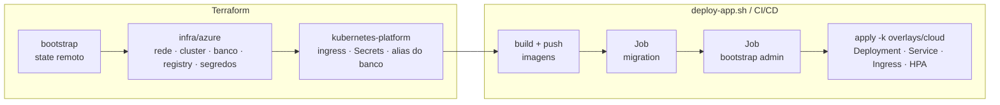

# Infraestrutura — Garage Flow API

Infraestrutura como código (Terraform) para executar a Garage Flow API em Kubernetes gerenciado, com PostgreSQL gerenciado, na **Azure** (assinatura Azure for Students do grupo).

As justificativas de cada escolha, com prós, contras e alternativas descartadas, estão em [docs/decisoes-de-infraestrutura.md](docs/decisoes-de-infraestrutura.md). A escolha da Azure como cloud do projeto está no [ADR-01](docs/decisoes-de-infraestrutura.md#adr-01--escolha-da-cloud-azure).

## Sumário

- [Visão geral](#visão-geral)
- [Arquitetura](#arquitetura)
- [Estrutura de pastas](#estrutura-de-pastas)
- [Recursos provisionados](#recursos-provisionados)
- [Pré-requisitos](#pré-requisitos)
- [Provisionamento na Azure](#provisionamento-na-azure)
- [Acesso do grupo à assinatura Azure](#acesso-do-grupo-à-assinatura-azure)
- [Trocar a assinatura Azure](#trocar-a-assinatura-azure)
- [Deploy da aplicação](#deploy-da-aplicação)
- [Remoção da infraestrutura](#remoção-da-infraestrutura)
- [Contrato para o pipeline de CI/CD](#contrato-para-o-pipeline-de-cicd)
- [Custos estimados](#custos-estimados)
- [Solução de problemas](#solução-de-problemas)
- [Limitações conhecidas](#limitações-conhecidas)

## Visão geral

| Camada | Responsável | Conteúdo |
| --- | --- | --- |
| Infraestrutura na Azure | Terraform (`infra/azure`) | Rede, cluster Kubernetes, PostgreSQL gerenciado, registry de imagens, cofre de segredos |
| Plataforma no cluster | Terraform (`infra/modules/kubernetes-platform`) | Ingress Controller, Secret da aplicação, alias DNS do banco |
| Aplicação | Kustomize (`k8s/` + `infra/kubernetes/overlays`) | ConfigMap, Deployment, Service, Ingress, HPA, Jobs de migration e bootstrap |

O Terraform cuida de tudo o que depende da Azure. Os manifestos de `k8s/` não são alterados: os overlays em `infra/kubernetes/overlays` reaproveitam esses arquivos e removem apenas o que, em cloud, é substituído por serviços gerenciados (PostgreSQL in-cluster e Secrets versionados).

Ambiente provisionado: **`staging`** (único).

## Arquitetura


### Fluxo de provisionamento e deploy



## Estrutura de pastas

```text
infra/
├── README.md                          # este guia
├── docs/
│   └── decisoes-de-infraestrutura.md  # decisões e trade-offs
├── azure/
│   ├── bootstrap/                     # Storage Account do state remoto
│   ├── modules/{network,cluster,database,registry,secrets}/
│   ├── environments/staging.tfvars
│   └── *.tf
├── modules/
│   └── kubernetes-platform/           # recursos dentro do cluster (Ingress, Secret, alias do banco)
├── kubernetes/
│   ├── components/                    # blocos Kustomize reutilizáveis
│   └── overlays/                      # cloud, cloud-migration, cloud-bootstrap-admin
└── scripts/
    ├── provision.sh                   # bootstrap + terraform apply
    ├── deploy-app.sh                  # imagens + Jobs + manifestos
    ├── destroy.sh                     # remoção ordenada
    └── setup-azure.sh                 # wizard de configuração da Azure
```

## Recursos provisionados

### Na Azure

| Recurso | Configuração | Finalidade |
| --- | --- | --- |
| Storage Account (bootstrap) | `gftfstate<sufixo>`, container `tfstate`, versionado | State remoto do Terraform |
| Resource Group | `rg-garage-flow-staging` | Agrupamento e remoção em bloco |
| VNet | `10.20.0.0/16` com subnets `snet-aks` e `snet-postgres` (delegada) | Rede isolada |
| Private DNS Zone | `garage-flow-staging.private.postgres.database.azure.com` | Resolução privada do banco |
| AKS | tier Free, 2× `Standard_B2als_v2` (2 vCPU / 4 GiB), Azure CNI Overlay, Managed Identity | Cluster Kubernetes gerenciado |
| Role assignments | `Network Contributor` (subnet), `AcrPull` (ACR) | Permissões da identidade do AKS |
| PostgreSQL Flexible Server | 16, `B_Standard_B1ms`, 32 GiB, acesso privado | Banco de dados da aplicação |
| ACR | Basic, sem usuário admin | Registry das imagens |
| Key Vault | modo RBAC, soft delete 7 dias, sem purge protection | Cópia consultável dos segredos gerados |
| Role assignments do Key Vault | `Key Vault Secrets Officer` para `secrets_officer_object_ids` + quem executa o Terraform | Acesso de pessoas e do pipeline aos secrets |

### Dentro do cluster

| Recurso | Origem | Finalidade |
| --- | --- | --- |
| Helm release `nginx-ingress` (namespace `ingress-nginx`) | Terraform | Ingress Controller com Service `LoadBalancer`, classe `nginx`; chart fixado em `ingress_chart_version` |
| Secret `garage-flow-secrets` | Terraform | `DATABASE_URL`, `POSTGRES_*`, `JWT_SECRET`, `TRACKING_TOKEN_SECRET`, `BUDGET_WEBHOOK_SECRET` (gerado), `SMTP_USER`/`SMTP_PASS` (de `TF_VAR_smtp_user`/`TF_VAR_smtp_pass`, vazios por padrão) |
| Secret `garage-flow-bootstrap-admin` | `deploy-app.sh`, só durante o Job de bootstrap | Credenciais do primeiro administrador (a senha fica no Key Vault) |
| Service `garage-flow-postgres` (ExternalName) | Terraform | Alias DNS para o banco gerenciado, preservando o host usado pelo Job de migration |
| ConfigMap, Deployment, Service, Ingress, HPA | `k8s/` via `overlays/cloud` | Aplicação |
| Jobs `garage-flow-migration`, `garage-flow-bootstrap-admin` | `k8s/` via overlays dedicados | Migrations e primeiro administrador |

## Pré-requisitos

| Ferramenta | Versão | Instalação (macOS) |
| --- | --- | --- |
| Terraform | ≥ 1.10 | `brew tap hashicorp/tap && brew install hashicorp/tap/terraform` |
| kubectl | ≥ 1.30 | `brew install kubectl` |
| Docker | com `buildx` | Docker Desktop |
| Azure CLI | — | `brew install azure-cli` |

> No Windows, use o Git Bash para executar os scripts. O pacote `terraform` do Homebrew core está congelado na versão 1.5 por questões de licença. Use o tap oficial `hashicorp/tap`.

## Provisionamento na Azure

### Caminho recomendado: wizard

```bash
infra/scripts/setup-azure.sh
```

O wizard conduz a configuração em 8 etapas e pode ser executado novamente sem perder as escolhas:

| Etapa | O que acontece | Onde o resultado fica |
| --- | --- | --- |
| 1. Ferramentas | Confere `terraform`, `az`, `kubectl` e Docker | — |
| 2. Login | `az login` no navegador, com a conta da universidade | Sessão do az CLI |
| 3. Assinatura | Lista as assinaturas e ativa a escolhida (Azure for Students) | `ARM_SUBSCRIPTION_ID` em `infra/azure/.env.azure` |
| 4. Serviços | Registra os resource providers usados pela stack | Assinatura Azure |
| 5. Região | Mostra as regiões permitidas pela policy e verifica a VM dos nodes, a quota de vCPUs e o SKU do PostgreSQL | `location` em `environments/staging.tfvars` |
| 6. Validação | `terraform init -backend=false` + `terraform validate` | — |
| 7. Provisionar | `provision.sh` (opcional, com confirmação) | Recursos na Azure |
| 8. Deploy | `deploy-app.sh` (opcional, requer Docker em execução) | Aplicação no AKS |

`infra/azure/.env.azure` é ignorado pelo Git e carregado automaticamente pelos scripts (`lib.sh`). Assim, `provision.sh`, `deploy-app.sh` e `destroy.sh` sempre usam a assinatura escolhida, mesmo que outra esteja ativa no az CLI.

Se o servidor SMTP exigir autenticação, exporte as credenciais antes do provisionamento. Elas são variáveis sensíveis do Terraform e não devem entrar no `staging.tfvars` versionado:

```bash
export TF_VAR_smtp_user='<usuario-smtp>'
export TF_VAR_smtp_pass='<senha-smtp>'
infra/scripts/provision.sh
```

No GitHub Actions, cadastre o login e a chave SMTP como repository secrets `SMTP_USER` e `SMTP_PASS`. O workflow `infra.yml` os repassa ao Terraform pelas mesmas variáveis `TF_VAR_*`; os valores não aparecem no workflow nem nos logs.

O ambiente cloud está configurado para o relay da Brevo (`smtp-relay.brevo.com:587`). Antes de implantar, substitua o endereço de `SMTP_FROM` em `k8s/configmap.yaml` por um remetente verificado na conta Brevo. No deploy cloud, `PUBLIC_BASE_URL` é substituída automaticamente por `http://<endereco-do-ingress>`.

<details>
<summary>Configuração manual, sem o wizard</summary>

```bash
az login
az account set --subscription "<nome-ou-id-da-assinatura>"
export ARM_SUBSCRIPTION_ID="$(az account show --query id --output tsv)"

for ns in Microsoft.ContainerService Microsoft.ContainerRegistry Microsoft.DBforPostgreSQL Microsoft.KeyVault Microsoft.Network Microsoft.Compute Microsoft.Storage Microsoft.ManagedIdentity; do
  az provider register --namespace "$ns" --wait
done

# Regiões permitidas pela policy da assinatura (Azure for Students)
az policy assignment list --disable-scope-strict-match --query "[].parameters.listOfAllowedLocations.value[]" --output tsv

infra/scripts/provision.sh
```

A região é definida em `location`, em `infra/azure/environments/staging.tfvars`. O `provision.sh` usa o mesmo valor para criar o state remoto (bootstrap).

</details>

### Particularidades da Azure for Students

- **Regiões:** a policy da assinatura limita onde recursos podem ser criados. Um erro `RequestDisallowedByPolicy` indica uma região fora da lista.
- **Quota de vCPUs:** a stack usa 2 nodes `Standard_B2als_v2` (4 vCPUs) e precisa de mais 2 vCPUs livres para upgrades do AKS. O wizard confere a quota na etapa 5.
- **Resource providers:** o provider `azurerm` registra apenas o conjunto básico mais os serviços da stack (`resource_provider_registrations = "core"`). O modo padrão tenta registrar dezenas de serviços e costuma falhar nesse tipo de assinatura.
- **Créditos:** a assinatura é desativada quando os créditos acabam. Execute `infra/scripts/destroy.sh` ao terminar cada sessão.

## Acesso do grupo à assinatura Azure

A stack Azure roda na assinatura de um membro. Os demais membros e o pipeline usam **as próprias identidades**; nenhuma credencial pessoal é compartilhada. Justificativa em [ADR-15](docs/decisoes-de-infraestrutura.md#adr-15--acesso-compartilhado-à-assinatura-azure).

### Membros do grupo

1. **Dono da assinatura**, no Portal: assinatura → *Controle de acesso (IAM)* → *Adicionar atribuição de função* → `Owner` (ou `Contributor` + `Role Based Access Control Administrator`) para a conta FIAP do membro. As contas FIAP já estão no tenant, então não é preciso convidar ninguém. Só `Contributor` não basta: a stack cria e remove role assignments.
2. **Membro:** obtém o próprio object ID e o envia ao dono para entrar em `secrets_officer_object_ids`, em `infra/azure/environments/staging.tfvars`:

   ```bash
   az ad signed-in-user show --query id --output tsv
   ```

3. **Membro:** executa `infra/scripts/setup-azure.sh` com a própria conta. A assinatura do grupo está fixada (ver abaixo), então o wizard não pergunta qual usar; só confere se a conta tem acesso. O `infra/azure/backend.hcl` versionado garante que todos usem o mesmo state remoto.

O Key Vault usa **Azure RBAC**: ser `Owner` da assinatura não dá leitura dos secrets. Quem precisar consultar o cofre (por exemplo, a senha do admin) deve estar em `secrets_officer_object_ids`. Quem executa o Terraform recebe o acesso automaticamente, mas, se não estiver na lista, o perde no próximo `apply` de outra pessoa.

### Assinatura fixada

A assinatura do grupo está fixada em dois arquivos versionados:

| Arquivo | Campo | Efeito |
| --- | --- | --- |
| `infra/azure/environments/staging.tfvars` | `subscription_id` | Onde o Terraform cria os recursos |
| `infra/azure/backend.hcl` | `subscription_id` | Onde fica o state remoto |

Com isso, os recursos são sempre criados nessa assinatura, independente da conta logada ou da assinatura ativa no az CLI. Os scripts (`lib.sh`) também apontam o az CLI para ela, para que `az acr login`, `az aks get-credentials` e `az keyvault` usem a mesma assinatura. Quem não tem role na assinatura recebe erro de acesso; nada é criado em outra assinatura.

### Pipeline (GitHub Actions)

Identidade criada uma única vez pelo dono da assinatura:

| Item | Valor |
| --- | --- |
| App registration / service principal | `sp-garage-flow-github-actions` |
| Credencial federada | issuer `https://token.actions.githubusercontent.com`, subject `repo:garage-flow-api/garage-flow-api:ref:refs/heads/main` |
| Roles na assinatura | `Contributor` + `Role Based Access Control Administrator` |
| Acesso aos secrets | object ID em `secrets_officer_object_ids` |

O workflow precisa de `permissions: id-token: write`, do login com `azure/login` (client ID, tenant ID e subscription ID, sem secret) e das variáveis abaixo para o Terraform. Nenhum desses IDs é segredo; podem ficar em *GitHub Variables*.

```yaml
env:
  ARM_USE_OIDC: "true"
  ARM_CLIENT_ID: ${{ vars.AZURE_CLIENT_ID }}
  ARM_TENANT_ID: ${{ vars.AZURE_TENANT_ID }}
  ARM_SUBSCRIPTION_ID: ${{ vars.AZURE_SUBSCRIPTION_ID }}
```

Para outros gatilhos (pull requests, tags, GitHub Environments), cadastre uma credencial federada adicional com o subject correspondente:

```bash
az ad app federated-credential create --id <app-object-id> --parameters '{"name":"github-pr","issuer":"https://token.actions.githubusercontent.com","subject":"repo:garage-flow-api/garage-flow-api:pull_request","audiences":["api://AzureADTokenExchange"]}'
```

## Trocar a assinatura Azure

Para usar outra assinatura (por exemplo, a Azure for Students de outro membro):

1. Em `infra/azure/environments/staging.tfvars`, troque `subscription_id` pelo ID da nova assinatura. Para voltar ao comportamento sem assinatura fixada, comente a linha; o wizard volta a perguntar qual usar.
2. Apague `infra/azure/backend.hcl`. O próximo `infra/scripts/provision.sh` executa o bootstrap na nova assinatura, cria outro state remoto e gera um novo `backend.hcl`, já com o `subscription_id` correto.
3. Em `secrets_officer_object_ids`, mantenha só quem tem acesso à nova assinatura. Se o pipeline for usado, crie um service principal na nova assinatura (ver [Pipeline](#pipeline-github-actions)) e substitua o object ID dele.
4. Execute `infra/scripts/setup-azure.sh` (registra os resource providers e valida a região na nova assinatura) e depois `infra/scripts/provision.sh`.
5. Versione o `staging.tfvars` e o novo `backend.hcl` para o restante do grupo.

> Antes de trocar, rode `infra/scripts/destroy.sh` na assinatura atual. O state antigo continua na assinatura anterior; os recursos dela não são migrados nem removidos automaticamente.

## Deploy da aplicação

Com a infraestrutura provisionada:

```bash
infra/scripts/deploy-app.sh
```

| Etapa | Comando equivalente |
| --- | --- |
| Login no registry | `terraform output -raw registry_login_command` |
| Build da API | `docker build --platform linux/amd64 --target production` |
| Build dos Jobs | `docker build --platform linux/amd64 --target build` |
| Push | `docker push <repositório>:<sha>` |
| kubeconfig | `terraform output -raw kubeconfig_command` |
| Migrations | `kubectl apply -k` do overlay `cloud-migration`, aguardando o Job concluir |
| Primeiro admin | Cria o Secret `garage-flow-bootstrap-admin` com os outputs `bootstrap_admin_*`, `kubectl apply -k` do overlay `cloud-bootstrap-admin`, aguarda o Job concluir e remove o Secret |
| API | Substitui `PUBLIC_BASE_URL` pelo host do Ingress, executa `kubectl apply -k` do overlay `cloud` e aguarda o rollout |

A tag das imagens é o SHA curto do commit, com sufixo `-dirty` se houver alterações locais não commitadas. Para usar outra tag: `infra/scripts/deploy-app.sh <tag>`.

Ao final, o script exibe a URL pública. Recursos úteis:

```bash
# Senha do primeiro administrador
eval "$(terraform -chdir=infra/azure output -raw secrets_read_command)"

# Estado do cluster
kubectl get pods,svc,ingress,hpa
kubectl top pods
```

### Teste de carga

`k6/load-test.js` aponta para `http://localhost:30080/health`. Para testar o ambiente em cloud, substitua a URL pelo endereço exibido no fim do deploy. Enquanto o teste roda, acompanhe o HPA:

```bash
kubectl get hpa garage-flow-hpa --watch
```

## Remoção da infraestrutura

```bash
infra/scripts/destroy.sh
```

Ordem de remoção:

1. aplicação e Jobs;
2. Ingress Controller, cujo Load Balancer é criado pelo Kubernetes, fora do Terraform;
3. `terraform destroy` de todos os demais recursos.

O state remoto do bootstrap é **preservado**. Ele é compartilhado pelo grupo; remova-o só ao encerrar o projeto, excluindo o resource group do state (a stack de bootstrap tem state local, só na máquina de quem a executou):

```bash
az group delete --name rg-garage-flow-tfstate
```

> **Importante:** os nodes do AKS, o PostgreSQL e o Load Balancer consomem créditos enquanto existirem. Execute o `destroy.sh` ao terminar cada sessão de trabalho ou gravação.

## Contrato para o pipeline de CI/CD

A stack expõe os outputs abaixo. O pipeline os lê com `terraform -chdir=infra/azure output -raw <nome>`.

| Output | Descrição |
| --- | --- |
| `environment` | `staging` |
| `cluster_name` | Nome do cluster |
| `kubeconfig_command` | Comando que configura o kubectl |
| `registry_url` | Host do registry |
| `registry_login_command` | Comando de `docker login` no registry |
| `api_image_repository` | Repositório da imagem da API (`--target production`) |
| `migration_image_repository` | Repositório da imagem dos Jobs (`--target build`) |
| `db_host` | Endpoint privado do PostgreSQL |
| `ingress_namespace` | Namespace do Ingress Controller |
| `secrets_store_ref` | Nome do Key Vault |
| `secrets_read_command` | Comando que exibe os segredos gerados |
| `bootstrap_admin_name`, `bootstrap_admin_email` | Nome e e-mail do primeiro administrador |
| `bootstrap_admin_password` | Senha do primeiro administrador (sensível), usada só para criar o Secret temporário do Job de bootstrap |

Sequência de deploy esperada: a mesma de [`scripts/deploy-app.sh`](scripts/deploy-app.sh). Cada bloco numerado do script corresponde a um step do pipeline.

Credenciais necessárias no pipeline: service principal `sp-garage-flow-github-actions` com credencial federada (OIDC), sem client secret (`ARM_USE_OIDC=true`, `ARM_CLIENT_ID`, `ARM_TENANT_ID`, `ARM_SUBSCRIPTION_ID`). Ver [Acesso do grupo à assinatura Azure](#acesso-do-grupo-à-assinatura-azure).

## Custos estimados

Valores on-demand aproximados, apenas para referência de consumo dos créditos.

| Azure (northcentralus) | US$/hora |
| --- | --- |
| AKS control plane (Free) | 0,00 |
| 2× Standard_B2als_v2 | ~0,075 |
| PostgreSQL B_Standard_B1ms + 32 GiB | ~0,02 |
| Standard Load Balancer + IP público | ~0,03 |
| ACR Basic | ~0,007 |
| **Total** | **~0,13 (~US$ 3/dia)** |

## Solução de problemas

| Sintoma | Causa provável | Ação |
| --- | --- | --- |
| `RequestDisallowedByPolicy` | Região fora da lista permitida pela assinatura | Rode `infra/scripts/setup-azure.sh` e escolha uma região permitida |
| `Sessão Azure inexistente` / `AADSTS...` | Login do az CLI expirado | `az login` (ou `infra/scripts/setup-azure.sh`) |
| `Forbidden` ao ler secrets do Key Vault | Object ID fora de `secrets_officer_object_ids` | Adicione o object ID ao `staging.tfvars` e rode `provision.sh` |
| Pods em `ImagePullBackOff` com `exec format error` | Imagem buildada para ARM | Use o `deploy-app.sh`, que força `--platform linux/amd64` |
| Job de migration em `Init` indefinidamente | Banco inacessível a partir do cluster | `kubectl logs job/garage-flow-migration -c wait-for-postgres`; confira a subnet delegada e a Private DNS Zone do banco |
| `self-signed certificate in certificate chain` | `DATABASE_URL` sem `uselibpqcompat=true` | Recrie o Secret com `terraform apply` |
| HPA com `<unknown>` | metrics-server ainda iniciando | Aguarde 1-2 minutos; `kubectl top nodes` |
| `destroy` falha ao remover a VNet ou a subnet | Recursos do Load Balancer ainda em remoção | Aguarde alguns minutos e execute `destroy.sh` novamente |

## Limitações conhecidas

- **Ambiente único** (`staging`). Para um novo ambiente: um novo `environments/<nome>.tfvars`, `ENVIRONMENT=<nome>` nos scripts e um bootstrap com `-var=environment=<nome>`, que gera uma key de state separada.
- **Sem HTTPS nem domínio próprio:** a API é exposta por `<ip>.nip.io`, via HTTP.
- **Nodes em número fixo:** o HPA escala pods, não nodes. O autoscaler do AKS fica desligado para manter o custo previsível e respeitar a quota de vCPUs da assinatura.
- **Banco sem alta disponibilidade** e sem réplica.
- Acompanhe com atenção o primeiro apply em uma assinatura nova, porque policies de assinatura e disponibilidade de SKUs variam por região.
- A conexão com o banco é **criptografada, mas sem validação da CA** (ver ADR-08).
